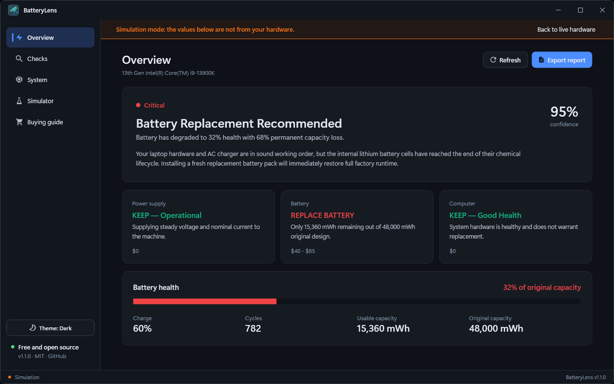
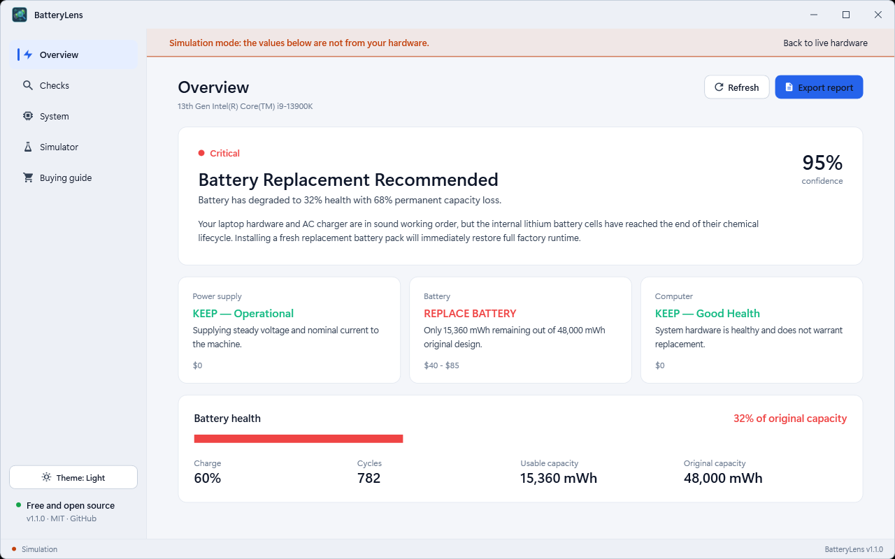

# BatteryLens — Laptop Battery Health & Capacity Analyzer

A Windows desktop tool (**.NET 10 / WPF**) that reads your PC's power sensors and tells you, in plain language, whether the **charger**, the **battery** or the **computer itself** needs attention, so you do not replace the wrong part. It compares original design capacity with current full-charge capacity, checks cycles, AC state and power draw, and gives a KEEP / REPLACE / CALIBRATE verdict for each part with the likely cost.



<details><summary>Light theme</summary>



</details>

## Download

Get the installer from the [latest release](https://github.com/md-anamul-hasan/batterylens/releases/latest) (Windows 10/11, 64-bit; self-contained, no .NET install needed) and check it against `SHA256SUMS.txt`. Release builds are intended to be code-signed with a free certificate from the [SignPath Foundation](https://signpath.org/) (see [Code signing policy](#code-signing-policy)); until the project is approved, Windows SmartScreen may warn about an unknown publisher.

## What it does

| Area | Behaviour |
|---|---|
| Three verdicts | Power supply, Battery and Computer are each rated KEEP, REPLACE or CALIBRATE ONLY, with the evidence and a typical cost |
| Battery health | Full-charge capacity versus design capacity (wear), charge level, cycle count and usable capacity in mWh |
| Checks | Capacity retention, wear level, charge cycles, AC adapter status and power draw / thermal state, each with its result |
| Hardware sources | `Win32_Battery` (root\cimv2), the `root\wmi` battery classes (static data, full-charged capacity, cycle count, status), `GetSystemPowerStatus` and `powercfg /batteryreport` |
| Simulator | Sample batteries (healthy, worn, charger fault, thermal drain, gauge out of sync) with live sliders, so you can see how verdicts change; also lets desktops and VMs without a battery try the app |
| Reports | Export a styled HTML report for a customer or a ticket, and generate the official Windows battery report |
| Buying guide | What to look for when a part really needs replacing, plus calibration steps |
| Other | Dark/light/system theme; self-contained, no .NET install needed |

Full walkthrough: [docs/USER_GUIDE.md](docs/USER_GUIDE.md).


## Build, test, run

```powershell
dotnet build BatteryLens.slnx
dotnet test  BatteryLens.slnx

# Self-contained installer in dist\installer (needs Inno Setup 6: winget install JRSoftware.InnoSetup)
.\scripts\build-installer.ps1

# Installer plus SHA256SUMS.txt in dist\release, ready to upload
.\scripts\package-release.ps1
```

The version comes from `Directory.Build.props`. Building needs the .NET 10 SDK; the installed app needs nothing else.

## Layout

```
Services/          hardware reader (WMI / power status / powercfg), diagnostic engine, report exporter, themes
Models/            battery info, presets, verdicts
ViewModels/        MVVM: MainViewModel
Controls/          title bar, status bar
Themes/            design tokens (dark/light), controls, icons
BatteryLens.Tests/ xUnit: diagnostic engine and presets
scripts/           build-installer.ps1, package-release.ps1, capture-media.ps1 (screenshots)
Directory.Build.props  single source of the product version
```

## Known limitations

- Desktop PCs and most VMs have no battery; BatteryLens says so and offers the simulator instead.
- Some laptops do not expose design capacity or cycle count through Windows, so those fields can be blank.
- Windows 10 (21H2+) and Windows 11, 64-bit only.

## License

[MIT](LICENSE). Free for personal and commercial use.

## Code signing policy

Free code signing for release builds is provided by [SignPath.io](https://about.signpath.io/), with a certificate from the [SignPath Foundation](https://signpath.org/), once the project is approved.

- Releases are built and signed only by the GitHub Actions workflow `.github/workflows/release.yml` from tagged commits of this repository.
- Only BatteryLens's own binary and its installer are signed.
- Maintainer and approver: Md Anamul Hasan ([@md-anamul-hasan](https://github.com/md-anamul-hasan)).

## Privacy

Full policy: [docs/PRIVACY.md](docs/PRIVACY.md).

BatteryLens makes no network connections and has no telemetry or update check. It reads local power sensors and writes reports only when you export them.
