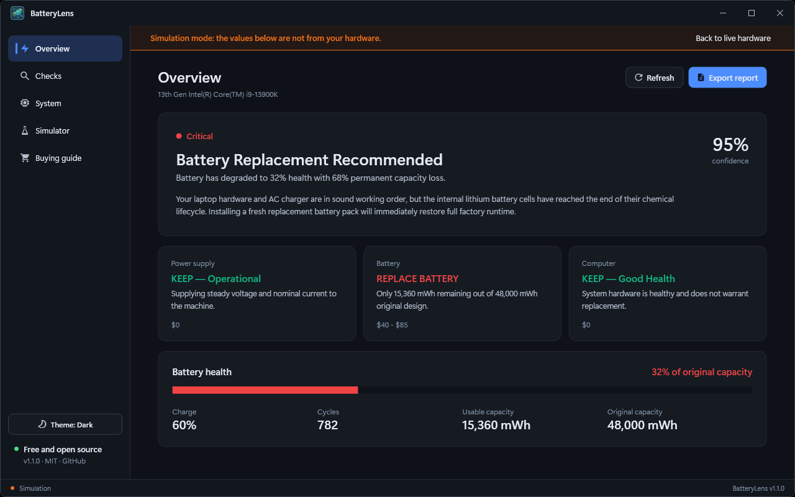

## BatteryLens 1.1.0

BatteryLens is now **free and open source (MIT)**. No licence key, no activation, no limits.

### Changed
- All features are unlocked; the licence dialog and evaluation mode are gone.
- The app makes no network connections at all now (the licence check was the only one).
- Export report is no longer limited.

### Files
| File | Purpose |
|---|---|
| `BatteryLens-Setup-1.1.0.exe` | Installer (self-contained, no .NET install needed) |
| `SHA256SUMS.txt` | Checksum for the file above |

Verify a download: `Get-FileHash .\BatteryLens-Setup-1.1.0.exe -Algorithm SHA256` and compare with `SHA256SUMS.txt`.

Builds are not code-signed yet, so Windows SmartScreen may warn about an unknown publisher.

Full list of changes: [CHANGELOG.md](https://github.com/md-anamul-hasan/batterylens/blob/main/CHANGELOG.md).
